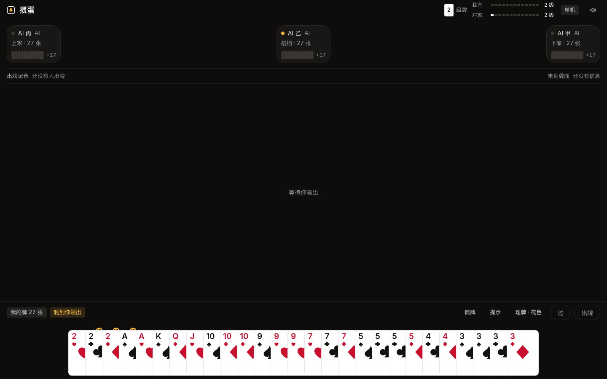
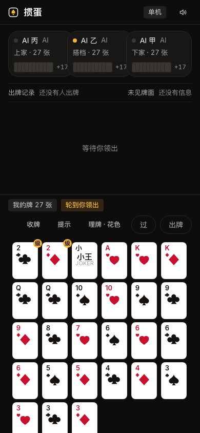

# 掼蛋

浏览器里打的掼蛋：纯前端、无需注册、开链接就能联机。规则按官方淮安/江苏掼蛋竞赛规则实现——级牌升级、逢人配、进贡还贡、同花顺、天炸一个不少。

**[在线试玩 →](https://garyleelty.github.io/guandan/)**

| 桌面 | 手机 |
| --- | --- |
|  |  |

## 怎么玩

### 一桌怎么打

- **四人两队**：对家是搭档，座位 0/2 一队，1/3 一队。两副牌，共 108 张，每人 27 张。
- **出牌方向**：每局第一手由上一局的头游先出（进贡局由进贡方先出）；一轮里没人再压，由最后出牌的人重新领出；可以随时「过」。
- **走完即游**：手里牌出完算走完，一局里依次决出头游、二游、三游、四游。
- **接风**：有人打出最后一手牌且没人压时，下一圈由他的搭档领出。

### 级牌与升级

- 每队一个**级牌**，从 2 打起，一直升到 A。级牌比 A 大，但不能当自己的点数出（顺子、连对里按原点数算）。
- **头游那队升级**：头游+二游（双下）升 3 级，头游+三游升 2 级，头游+四游升 1 级。
- 打到 A 级要**双下**（1+2 名同队）才算拿下整场。
- 一局里最后一名是**下游**，下游那队下一局赢不了整场（即使双下也只升 2 级）。

### 进贡与还贡

- 局与局之间：上局的**下游向上游进贡**一张最大的牌（红桃级牌不能交）；上游还一张 10 以下的牌（级牌不能还）。
- 出现**双下**时，三游、四游各交一张，大的给头游、小的给二游。
- 进贡方手里合计有两张**大王可以抗贡**：全队免贡，由头游领出。
- 进贡后由进贡的下游先出牌（抗贡则由头游领出）。

### 牌型与大小

| 牌型 | 说明 |
| --- | --- |
| 单张 / 对子 / 三张 | 基础型，同型比点数 |
| 三带二 | 比较只看三张 |
| 顺子 | 正好 5 张连牌，A 可高（10JQKA）可低（A2345） |
| 连对 | 3 对以上连续对子 |
| 钢板 | 连续 2 组以上三张 |
| 炸弹 | 4 张及以上同点，压一切常规牌型；张数多的大 |
| 同花顺 | 同花色的 5 张顺，压 5 张及以下的炸弹；6 张以上的炸弹反压同花顺 |
| 天炸 | 大小王四张齐（双小王+双大王），最大 |

- **级牌**比 A 大、比小王小；**逢人配**（红桃级牌）是万能牌，可当任意点数搭配使用（凑对子、进顺子都行），单出时只算普通级牌。
- 手里剩 10 张及以内要报牌——数字牌桌会自动亮出来。

## 上手操作

大厅里三件事：**昵称、AI 难度（简单/普通/难）、开局方式**：

- **单机开局**：你 + 3 个 AI，随时打随时退，进度本机自动存档可续局。
- **创建房间（P2P）**：生成 6 位房号，把链接发给朋友即可加入，空位由 AI 补位。
- **通过链接加入**：直接点房主分享的链接进房间。

牌桌上的常用功能：

- **提示**：按 AI 的走法替你选好牌；**记牌器**显示各家还剩多少张某个点数。
- **牌谱**：回看这一局每一手出的真实牌面；**堆叠视图**按点数×花色矩阵看牌、同花顺自动高亮。
- 剩 10 张以内自动报牌；每手有回合计时托管，超时自动出牌（单机不掉线时托管）。
- 结算页可开**自动续局**（3 秒倒计时自动开下一局），也可回看**牌谱回放**。

## 联机细节

- 直连为 **WebRTC P2P**，牌局数据不经服务器存储；信令默认走 PeerJS 公共云，可用环境变量指向自建（`VITE_PEER_HOST` / `VITE_PEER_PORT` / `VITE_PEER_PATH` / `VITE_PEER_SECURE`）。
- 房主掉线自动**房主转移**：最低座位的人类客人接管当权威；客人掉线由 AI 接手，重连坐回原座。
- 房主可以**观战**（只看牌不上桌）、踢人、加/减 AI。

## 本地开发

```bash
bun install        # 或 npm install
bun run dev        # http://localhost:5173
bun run test       # vitest：引擎/牌型/进贡/AI 等单测
bun run typecheck  # tsc -b --noEmit
bun run build      # tsc + vite build（GH_PAGES=1 时 base 为 /guandan/）
```

- `scripts/smoke-*.mjs`：P2P、断线重连、房主转移、进贡、回放等端到端冒烟脚本。
- `scripts/soak-matches.ts`：AI 对打 soak 回归。
- 每次推 `main` 自动部署到 GitHub Pages；测试与部署分别由 `ci.yml` / `deploy.yml` 跑。

## 目录速览

```
src/core/   牌、牌型识别、对局引擎、AI、进贡、回放、统计
src/net/    PeerJS 房间、房主/客人协议、回合计时
src/ui/     大厅、牌桌、手牌、牌谱、回放、玩法说明
src/state/  zustand 全局状态、单机存档
```
